# Task 1 — Multi-container Pods: Init Container and Sidecar

## Overview

Deploy an Nginx page on a three-node Minikube cluster. Each Pod contains an init container, an Nginx container, and a sidecar that updates the page timestamp every five seconds. The task also tests what happens when the init container fails.

The page displays:

```text
hello in MLOPS MENA COMMUNITY : YYYY-MM-DD HH:MM:SS
```

## Environment

| Component | Configuration |
|---|---|
| Host OS | Ubuntu 24.04.4 LTS |
| Container engine | Docker Engine 29.1.3 |
| Minikube driver | Docker |
| Kubernetes | v1.37.0 |
| Cluster | 3 nodes: 1 control-plane, 2 workers |
| CNI | Calico |

Cluster startup command:

```bash
minikube start --nodes 3 --cni=calico --cpus 2 --memory 2200
```

## Application

The application runs in the `webapp` namespace as a Deployment named `web-deployment`, with three replicas and the label `app: web`.

| Container | Image | Purpose |
|---|---|---|
| `init-done` | `busybox:1.36` | Prints `done` and exits successfully before the application containers start. |
| `nginx` | `nginx:1.27` | Creates and serves the HTML page on port 80. |
| `time-updater` | `busybox:1.36` | Updates the HTML timestamp every five seconds. |

The Pod uses `shareProcessNamespace: true`, allowing the sidecar to find the Nginx process. The sidecar updates the page through `/proc/<nginx-pid>/root`. It is granted the `SYS_PTRACE` capability. No application volumes are configured.

## Deployment

Create the namespace and deploy the application:

```bash
kubectl apply -f namespace.yaml
kubectl apply -f deployment.yaml
```

Check the Deployment and Pods:

```bash
kubectl get deployment web-deployment -n webapp
kubectl get pods -n webapp -l app=web -o wide
```

The expected result is three Pods, each showing `2/2 Running`. The init container has already completed, so only the two application containers are counted as ready.

Forward port 80 to the local machine:

```bash
kubectl port-forward -n webapp deployment/web-deployment 8080:80
```

Open [http://localhost:8080](http://localhost:8080) to view the page.

## Sidecar verification

The sidecar can see the Nginx process:

```bash
kubectl exec deployment/web-deployment -n webapp -c time-updater -- ps
```

Check the HTML twice, with a delay of more than five seconds:

```bash
kubectl exec deployment/web-deployment -n webapp -c nginx -- cat /usr/share/nginx/html/index.html
sleep 6
kubectl exec deployment/web-deployment -n webapp -c nginx -- cat /usr/share/nginx/html/index.html
```

The timestamp changes between the two checks.

## Init container failure test

The init container command was changed to:

```yaml
command: ["sh", "-c", "echo 'init failed'; exit 1"]
```

After applying the updated manifest, the new Pod entered `Init:CrashLoopBackOff`. The init container terminated with exit code `1`, and the Nginx and sidecar containers did not start. The three existing Pods remained available, and the page continued to respond.

The failed Pod was inspected with:

```bash
kubectl logs <failed-pod-name> -n webapp -c init-done --previous
kubectl describe pod <failed-pod-name> -n webapp
```

The logs show `init failed`, and the Pod description reports `Exit Code: 1`.

## Recovery

The init container command was restored to:

```yaml
command: ["sh", "-c", "echo done"]
```

The corrected manifest was applied and the Deployment was checked:

```bash
kubectl apply -f deployment.yaml
kubectl rollout status deployment/web-deployment -n webapp
kubectl get deployment web-deployment -n webapp
kubectl get pods -n webapp -l app=web
```

The final state is three ready replicas, with each Pod showing `2/2 Running`.

## Verification Screenshots

The screenshots correspond to the 11 verification points in the assignment.

| # | Verification | Screenshot |
|---|---|---|
| 1 | Three cluster nodes are Ready | 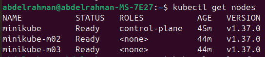 |
| 2 | Deployment has three ready replicas | 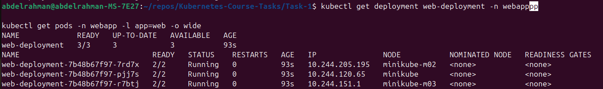 |
| 3 | Three application Pods are Running | 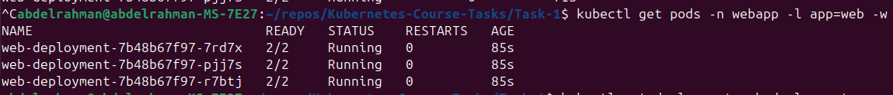 |
| 4 | Init and application container names | 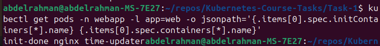 |
| 5 | Init container completes successfully | 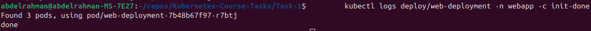 |
| 6 | Sidecar can see the Nginx process | 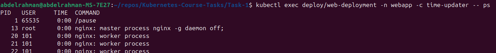 |
| 7 | Page timestamp updates | 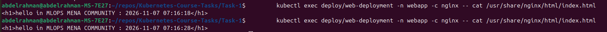 |
| 8 | No application volumes are configured | 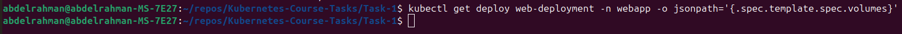 |
| 9 | Failed init container and Pod status | 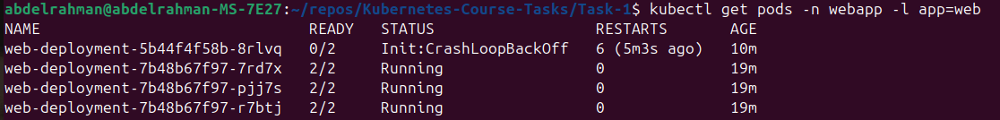 |
| 10 | Init container exit code is 1 | 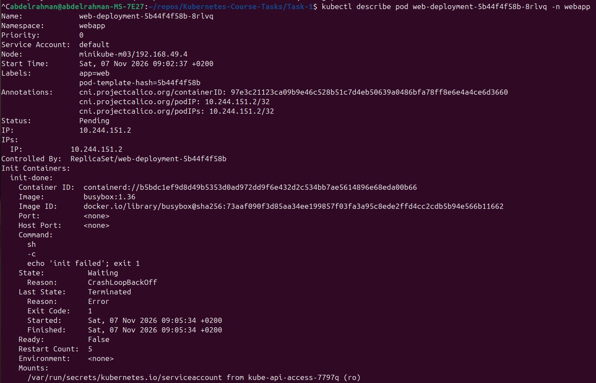 |
| 11 | Deployment is restored to three replicas | 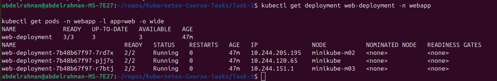 |

## Files

```text
Task-1/
├── README.md
├── namespace.yaml
├── deployment.yaml
└── assets/
    ├── v1.png
    ├── v2.png
    ├── v3.png
    ├── v4.png
    ├── v5.png
    ├── v6.png
    ├── v7.png
    ├── v8.png
    ├── v9.png
    ├── v10.png
    └── v11.png
```

