# Task 2: FastAPI and MySQL with Persistent Storage, ConfigMap, Secret, and Ingress

## Overview

Deployed a FastAPI guestbook application with a MySQL database on a three-node Minikube cluster.

The application uses Kubernetes ConfigMaps and Secrets for configuration, a PersistentVolume and PersistentVolumeClaim for database storage, Services for internal communication, and an NGINX Ingress Controller for HTTP access.

## Architecture

```text
Browser
  |
  v
NGINX Ingress Controller
  |
  v
Ingress: webapp-ingress
  |
  v
Service: webapp-api (80 -> 8000)
  |
  v
FastAPI Deployment (2 replicas)
  |
  v
Service: mysql (3306)
  |
  v
MySQL Deployment (1 replica)
  |
  v
PVC: mysql-pvc
  |
  v
PV: mysql-pv
  |
  v
/data/webapp-mysql on minikube-m02
```

## Environment

- OS: Ubuntu 24.04 LTS
- Container build tool: Docker
- Kubernetes environment: Minikube, three nodes
- CNI: Calico
- Ingress controller: NGINX Minikube addon

## Application Images

Built the provided Dockerfiles and loaded both images into Minikube:

```bash
chmod -x mysql/initdb/01-setup.sh

docker build -t webapp-api:task2 ./webapp
docker build -t webapp-mysql:task2 ./mysql

minikube image load webapp-api:task2
minikube image load webapp-mysql:task2

minikube image ls
```

Both Deployments use `imagePullPolicy: IfNotPresent`.

## Kubernetes Resources

All resources are in the `webapp-stack` namespace except the PersistentVolume, which is cluster-scoped.

| Resource | Name | Configuration |
|---|---|---|
| Namespace | `webapp-stack` | Application namespace |
| Secret | `mysql-secret` | MySQL root password, application username, and application password |
| ConfigMap | `webapp-config` | Application title, environment, MySQL host, port, and database name |
| PersistentVolume | `mysql-pv` | 2Gi, ReadWriteOnce, `hostPath`, `Retain`, storage class `manual` |
| PersistentVolumeClaim | `mysql-pvc` | 2Gi, ReadWriteOnce, bound to `mysql-pv` |
| MySQL Deployment | `mysql` | One replica, `Recreate` strategy |
| MySQL Service | `mysql` | ClusterIP, port 3306 |
| FastAPI Deployment | `webapp-api` | Two replicas, container port 8000 |
| FastAPI Service | `webapp-api` | ClusterIP, port 80 targeting port 8000 |
| Ingress | `webapp-ingress` | NGINX, `/` path with `Prefix` matching |

### Configuration and credentials

The `webapp-config` ConfigMap provides:

- `APP_TITLE`
- `APP_ENV`
- `MYSQL_HOST`
- `MYSQL_PORT`
- `MYSQL_DATABASE`

The `mysql-secret` Secret provides the MySQL root password, application database user, and application password. The credentials are injected into the MySQL and FastAPI containers through `secretKeyRef` rather than being embedded in the Deployment manifests.

### Persistent storage

The MySQL data directory `/var/lib/mysql` is mounted from `mysql-pvc`. The claim binds to `mysql-pv`, which uses the host directory `/data/webapp-mysql` on `minikube-m02`.

Node affinity pins the PV to `minikube-m02`, ensuring that a replacement MySQL Pod uses the node where the `hostPath` data is stored. The PV uses the `Retain` reclaim policy.

### MySQL Deployment

The MySQL Deployment has one replica and uses the `Recreate` strategy to avoid running two database Pods against the same data directory. Readiness and liveness probes use `mysqladmin ping`.

### FastAPI Deployment

The FastAPI Deployment has two replicas. ConfigMap values are loaded using `envFrom`, while `MYSQL_USER` and `MYSQL_PASSWORD` are loaded from the Secret. Readiness and liveness probes check the `/health` endpoint on port 8000.

### Ingress access

The Minikube NGINX Ingress addon was enabled, and `webapp-ingress` routes `/` to the `webapp-api` Service on port 80.

The Ingress Controller was exposed locally with:

```bash
kubectl port-forward -n ingress-nginx svc/ingress-nginx-controller 8080:80
```

The application was accessed at `http://localhost:8080`.

## Verification

All 12 checks from the task instructions were completed. Screenshots are stored in `assets/`.

### 1. Images loaded

Confirmed that `webapp-api:task2` and `webapp-mysql:task2` are available in Minikube.

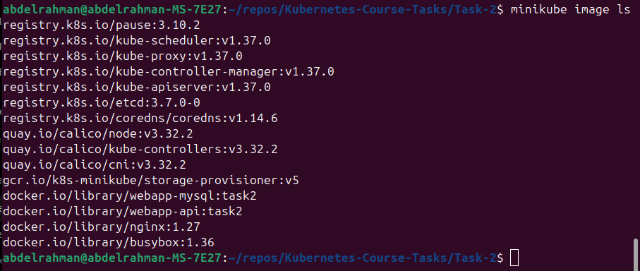

### 2. Secret and ConfigMap

Confirmed that `mysql-secret` contains three keys and `webapp-config` contains five keys.

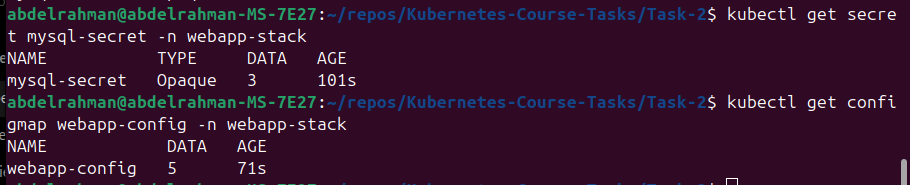

### 3. PersistentVolume and PersistentVolumeClaim bound

Confirmed that `mysql-pv` and `mysql-pvc` are both `Bound` with a capacity of 2Gi.

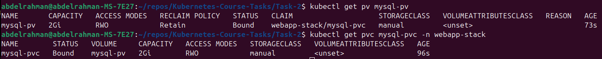

### 4. Deployments ready

Confirmed that the MySQL Deployment is ready with one replica and the FastAPI Deployment is ready with two replicas.

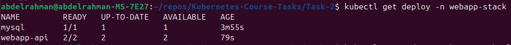

### 5. MySQL scheduled on the PV node

Confirmed that the MySQL Pod is running on `minikube-m02`, matching the PV node affinity.

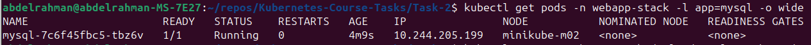

### 6. Application environment variables

Confirmed that the FastAPI container receives the required application settings and MySQL connection variables from the ConfigMap and Secret.

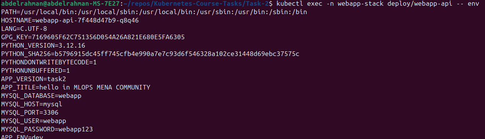

### 7. Default database records

Confirmed that the `webapp.messages` table contains the two initialization records:

| ID | Author | Content |
|---:|---|---|
| 1 | admin | Welcome to the WebApp guestbook! |
| 2 | k8s-labs | This message was created when the database was initialized. |

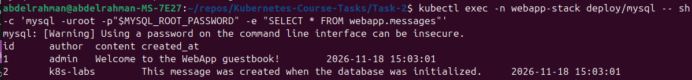

### 8. Ingress

Confirmed that `webapp-ingress` uses the `nginx` IngressClass and has an assigned address.

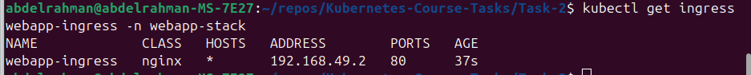

### 9. Application information endpoint

Confirmed that `/api/info` returns the expected application version, title, environment, and MySQL server information.

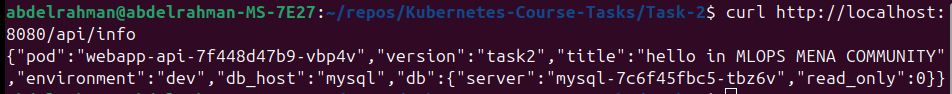

### 10. Write a message

Sent a POST request to `/api/messages` with author `student` and content `hello`. The API returned the created record with ID 3.

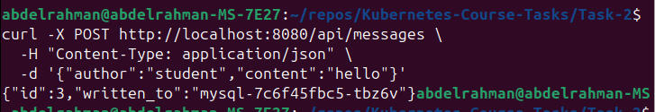

### 11. Read messages

Confirmed that the API returns the two initialization records and the newly created message.

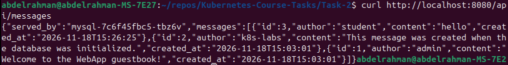

### 12. Data survives a MySQL Pod restart

Deleted the MySQL Pod and allowed the Deployment to create a replacement. Confirmed that the message records remained available after the new Pod started, demonstrating that the database data is stored on the PV rather than in the Pod's temporary filesystem.

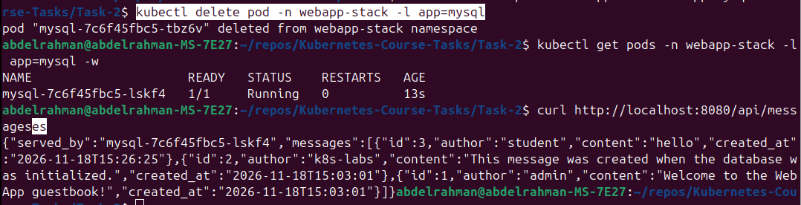

## Project Files

```text
Task-2/
├── README.md
├── namespace.yaml
├── secret.yaml
├── configmap.yaml
├── storage.yaml
├── mysql.yaml
├── webapp.yaml
├── ingress.yaml
├── webapp/
├── mysql/
└── assets/
    ├── v1.png
    ├── v2.png
    ├── v3.png
    ├── v4.png
    ├── v5.png
    ├── v6.png
    ├── v7.png
    ├── v8.png
    ├── v9.png
    ├── v10.png
    ├── v11.png
    └── v12.png
```

The application and MySQL source folders and Dockerfiles were provided for the task. The Kubernetes manifests define the namespace, Secret, ConfigMap, storage resources, Deployments, Services, and Ingress.

## Cleanup

The resources and Minikube cluster were kept running for the next course task, as required by the task instructions.
